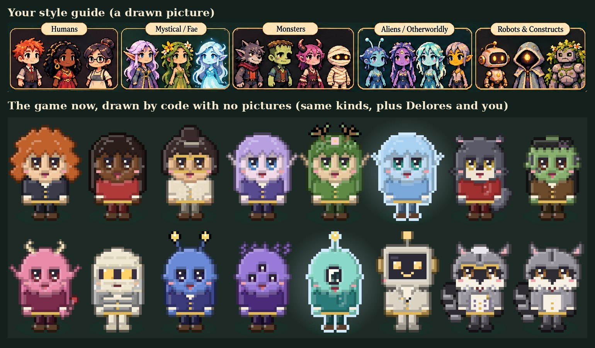
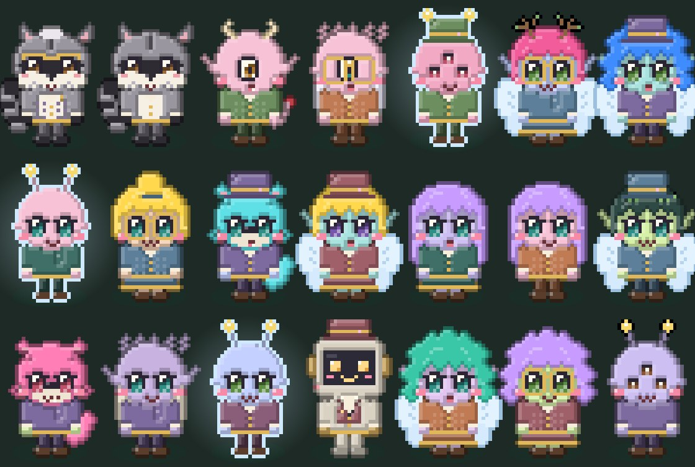
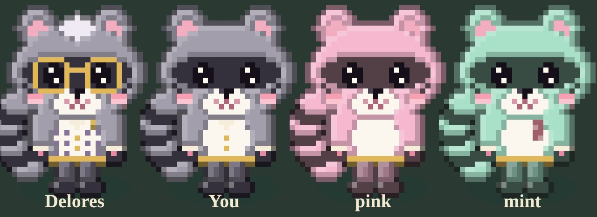
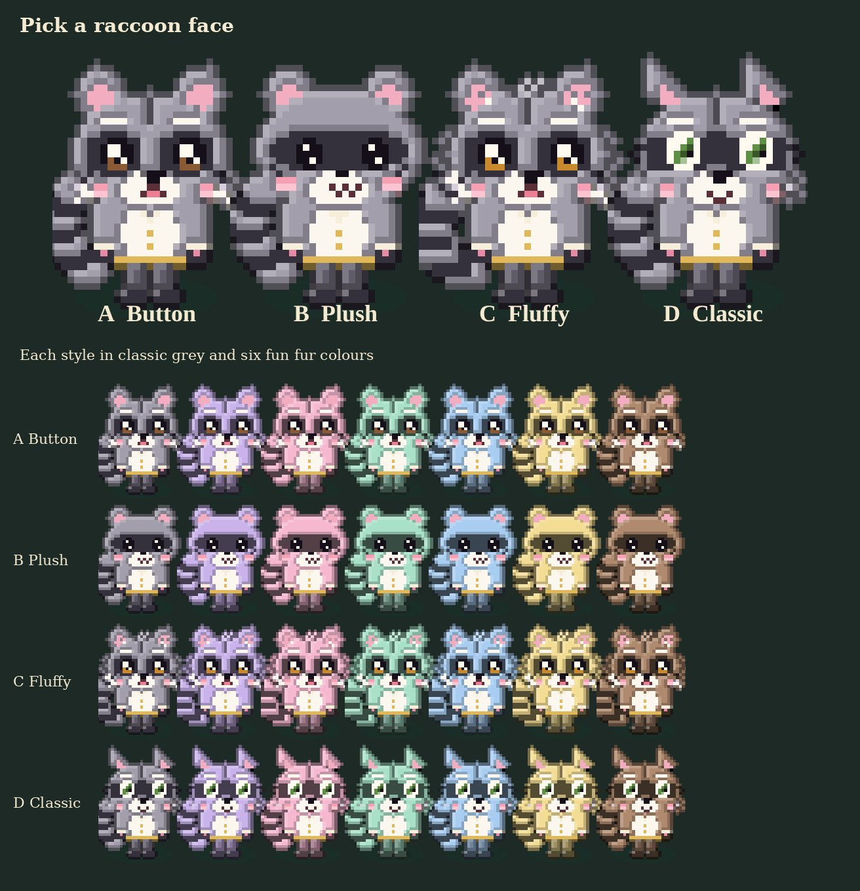

# Character kit

Every character in Mapáchez Manor is drawn with code from a short recipe. There are no pictures, so the whole kit is about 52 KB inside, player picker included, `index.html`.

## Pixel chibi look (v3)

Every character is now painted like pixel art, following the Character Style Guide picture: a big head, big glossy eyes with a white sparkle, chunky hair with shine, a soft coloured outline and light from the top left. Each one is painted on a small 32 by 44 pixel grid from its recipe, then scaled up crisply with no blur.

The whole cast uses it:
- **Raccoons** (Delores, her family and the default player): mask, pink inner ears, ringed tail, cheek fluff and whiskers.
- **People**: short, long, bun or curly hair, skirts or trousers, glasses.
- **Folklore beings**: pointed ears, antlers, leaf crowns with a flower, fairy wings, goat horns with hooves, or a soft glow.
- **Monsters**: a wolf with ears, muzzle and tail; a stitched monster with a flat top and neck bolts; a horned imp with a tail; a mummy with wraps and glowing eyes. Which one a monster is comes from its recipe.
- **Aliens**: antennae with glowing bulbs or head tentacles, with one, two or three eyes.
- **Robots**: a screen face with lamp eyes and a little antenna.
- **Muffin**: drawn small, given crisp edges and the same soft outline, so she matches everyone else.

**Candy colours and extra cute (v3.1).** About three in four beings get a fun skin colour (mint, lavender, sky blue, pink, butter yellow, peach) and most get bright hair (pink, blue, purple, yellow, green, teal, orange). Raccoons and robots keep their own colours. Eyes are bigger with two sparkles, cheeks are rosy, mouths are small (a cat "w", a tiny smile or a little "o"), outlines are softer, a blink is a happy closed "^", and robots have pink cheeks on their screen. The new colour rolls come after all the old ones, so every named character keeps their kind and shape. The "Who are you?" picker offers the new skins and hair colours too.

**Extra-cute raccoons.** Raccoons have their own faces. The "button" style has: a round fluffy head with cheek tufts, big round ears with pink insides, soft bandit patches, huge shiny eyes with big sparkles, little white brows, a button nose, a tiny open smile, rosy cheeks, pink paw pads and a bigger ringed tail. Blinks are happy "^" arcs.

**Raccoon styles and colours.** There are four raccoon face styles: plush (the default, chosen by the owner), button, fluffy and classic. Set one with `rstyle` on a recipe, for example in `CAST_PINS`. Any raccoon can have a `fur` colour, and the classic grey is used when none is set. About one guest in ten turns out to be a raccoon, and about half of those have fun fur (lilac, pink, mint, sky, butter, cocoa, peach or periwinkle). Delores stays classic grey. Player raccoons can pick a fur colour on the "Who are you?" screen.

Each grid is made once per direction, walking step and blink, kept in memory and reused, so 30 characters take about 0.2 ms a frame. The kit is about 39 KB, smaller than the v2 detail kit (about 52 KB).

**How close code can get.** The shapes, proportions, outlines and eyes match the style guide well. A hand-drawn sprite sheet would still win on things like flowing hair locks, dress folds and changing facial expressions, because an artist places every pixel by eye. Getting that here would mean adding picture files, which the game avoids to stay free and light.

## Who is what

- **Delores and her family are always raccoons.** The family list is `CAST_FAMILY`. Add a name there to make that character a raccoon.
- **Players choose what they are.** The "Who are you?" button on the title screen opens one simple screen. Players pick Raccoon, Person, Fae folk, Monster, Alien or Robot, tap a few ↻ buttons and a colour, or hit 🎲 Randomize. Raccoon is the default, so anyone can skip it, and existing players stay raccoons. The choice is saved under `mapachez_player_v1`. Their wardrobe coat is still their vest.
- **Pronouns are optional.** On the same screen, players can tap she/her, he/him and they/them, choosing more than one, or type their own (for example xe/xem/xyr). Anyone who skips it is called "they". In Spanish, skipping means no gendered word at all: Delores says "esta persona". Choosing they/them gives "elle". With more than one pronoun, the game uses a different one each night. Pronouns stay on the player's device only and never go into score codes or the team report. For now they're used in Delores's welcome line, and `playerPronouns()` is there for future lines.

- **Everyone else is random.** A character's name picks their kind and look. The kind can be a person, a folklore being, a monster, an alien or a gentle robot. Folklore beings include fauns with goat horns and hooves, dryads with antlers or leaf crowns, fairies with wings, and pale glowing ones. The look covers body (round, tall, blob or wiggly), eyes (one, two or three), hairdo, extras and outfit (vest, scarf, bow, cardigan or hat). Mythology stays with folklore creatures, never gods people worship today.
- **Named characters keep their look.** The same name always gives the same look, so Mr. Finch looks the same every night. Characters who already had colours in the game keep them as their body and outfit colours.
- **Unnamed guests are new each time.** A guest moment without a guest name gets a fresh look.
- **To fix a look by hand**, add it to `CAST_PINS`, for example `finch:{kind:'alien',body:'tall',eyes:3}`.
- **Nothing is labelled.** The game never says who is a monster or an alien, in line with the "show, don't label" rule in AGENTS.md.

Behind the picker, `CAST_OPTIONS` lists every choice, and `castMake({...choices})` turns choices into a look `drawBeing` can draw. Unlockable outfits or a photo booth could build on this later.

A few older lines still assume the player is a raccoon, such as "Raccoon instinct" and "The raccoon at the desk". They read as a fond running joke even for a robot, so they were left as they are.

To give a festival booth a staffer later, use any name, such as `drawPerson(c,x,y,{cast:'booth:Tide & Fern'})` or `castLook('booth:Tide & Fern')`. That booth then has one fixed being.

## Muffin, Cece's cat

Muffin lives her own little life in the Festival Garden. Where she is depends on the season, the weather and the night:

| When | Where | What she's doing |
| --- | --- | --- |
| Spring | Flowers by the fountain | Sniffing flowers while a butterfly flutters past |
| Summer | Under the big trees | Eating a strawberry in the shade |
| Autumn | Pumpkins by Little Island Press | Peeking out from behind them |
| Winter | Lantern beside the stage | Asleep in a plaid blanket |
| Rain or storm | Under the Tide & Fern booth | Hiding |
| Fireflies | On the lawn | Watching the fireflies |
| Every 5th night | In front of the stage | Waddling about in tiny headphones for the Silent Sessions |
| The night after | A low branch | Hanging upside down, thinking |

Weather follows the weather feature (PR 7) and the surprise storm nights (PR 6) when those are in the game. Without them, Muffin follows the season.

Tapping Muffin, or pressing E beside her, plays a tiny reaction. She shows a heart, then wiggles her ears, then yawns. There are no points, timers or tasks.

On every other night, Cece walks the garden asking "Have you seen my cat?". Talking to her rotates five lines. One of them opens her pet profile:

> Species: Cat (according to owner) · Breed: Unconfirmed · Dietary preference: Strawberries · Special instructions: Do not question her heritage.

Nobody says what Muffin is, and the game doesn't either. A test checks that the kit never names her species.

## Checks

`python tests/test_cast.py` (set `CHROMIUM_PATH`). It checks that the kit stays small, that the family are raccoons, that named looks never change, that 300 random beings and every creator choice draw cleanly in all four directions, that Muffin and Cece work, and that the picker and pronouns (English and Spanish) save and read correctly.
