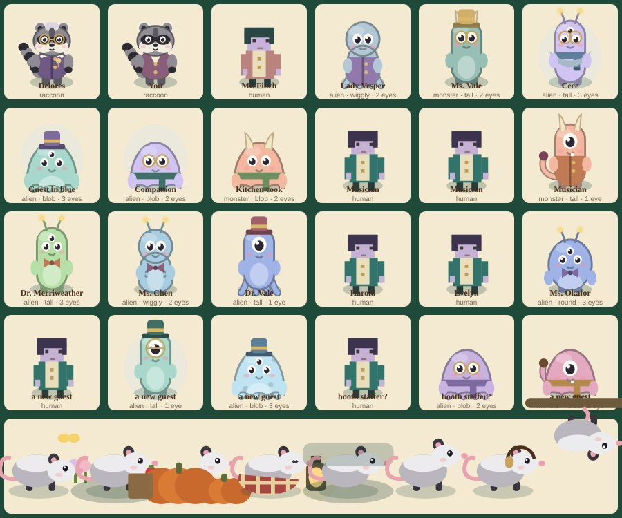

# Character kit

Every character in Mapáchez Manor is drawn with code from a short recipe. There are no pictures, so the whole kit is about 21 KB inside `index.html`.

## Who is what

- **Delores, her family and the player are always raccoons.** The family list is `CAST_FAMILY`. Add a name there to make that character a raccoon.
- **Everyone else is random.** A character's name picks their kind (monster, alien or human), body (round, tall, blob or wiggly), eyes (one, two or three), extras (horns, ears, fur, tail, spots, antennae, tentacles or a soft glow) and outfit (vest, scarf, bow, cardigan or hat).
- **Named characters keep their look.** The same name always gives the same look, so Mr. Finch looks the same every night. Characters who already had colours in the game keep them as their body and outfit colours.
- **Unnamed guests are new each time.** A guest moment without a guest name gets a fresh look.
- **To fix a look by hand**, add it to `CAST_PINS`, for example `finch:{kind:'alien',body:'tall',eyes:3}`.
- **Nothing is labelled.** The game never says who is a monster or an alien, in line with the "show, don't label" rule in AGENTS.md.

To give a festival booth a staffer later, use any name, such as `drawPerson(c,x,y,{cast:'booth:Tide & Fern'})` or `castLook('booth:Tide & Fern')`. That booth then has one fixed being.

## Muffin, Cece's cat

Muffin lives her own little life in the Festival Garden. Where she is depends on the season, the weather and the night:

| When | Where | What she's doing |
| --- | --- | --- |
| Spring | Flowers by the fountain | Sniffing flowers while a butterfly flutters past |
| Summer | Under the big trees | Eating a strawberry in the shade |
| Autumn | Pumpkins by Little Island Press | Peeking out from behind them |
| Winter | Lantern beside the stage | Asleep in a plaid blanket |
| Rain or storm | Under the Tide & Fern booth | Hiding |
| Fireflies | On the lawn | Watching the fireflies |
| Every 5th night | In front of the stage | Waddling about in tiny headphones for the Silent Sessions |
| The night after | A low branch | Hanging upside down, thinking |

Weather follows the weather feature (PR 7) and the surprise storm nights (PR 6) when those are in the game. Without them, Muffin follows the season.

Tapping Muffin, or pressing E beside her, plays a tiny reaction. She shows a heart, then wiggles her ears, then yawns. There are no points, timers or tasks.

On every other night, Cece walks the garden asking "Have you seen my cat?". Talking to her rotates five lines. One of them opens her pet profile:

> Species: Cat (according to owner) · Breed: Unconfirmed · Dietary preference: Strawberries · Special instructions: Do not question her heritage.

Nobody says what Muffin is, and the game doesn't either. A test checks that the kit never names her species.

## Checks

`python tests/test_cast.py` (set `CHROMIUM_PATH`). It checks that the kit stays small, that the family are raccoons, that named looks never change, that 300 random beings draw cleanly in all four directions, and that Muffin and Cece work.
