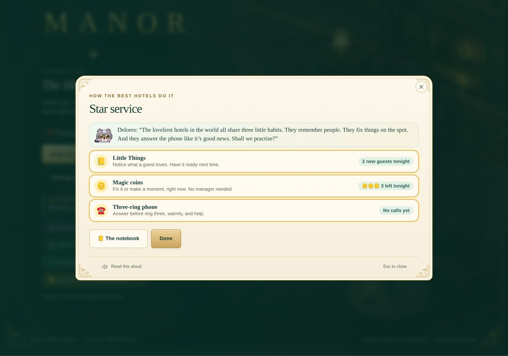
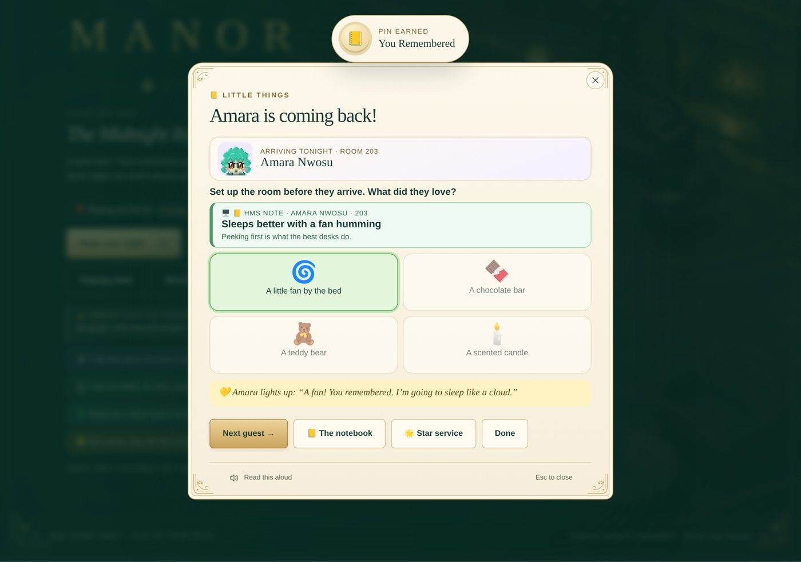
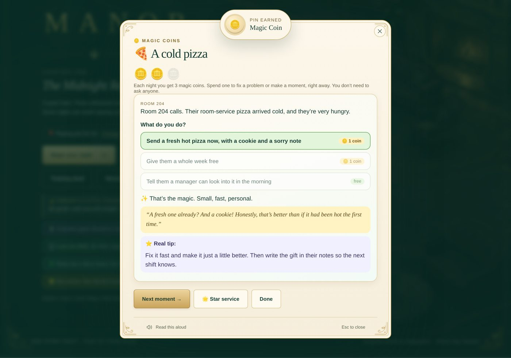
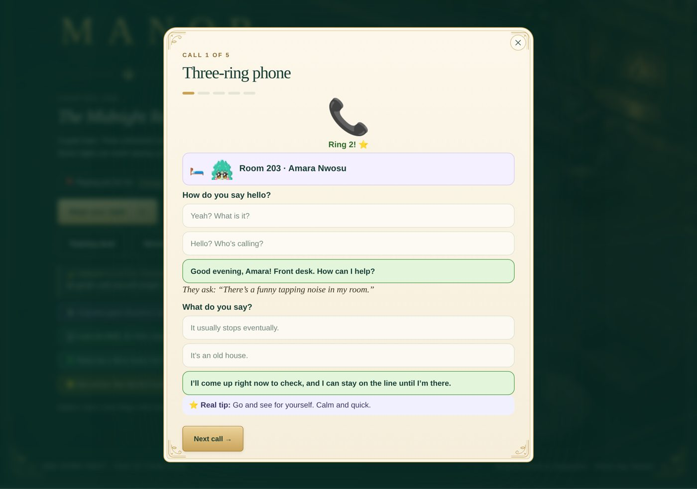

# STAR SERVICE v1: how the best hotels do it

Three habits that the world's top-rated hotels share, turned into quick little games. Only the
ideas are borrowed: no hotel names, ratings brands or logos appear anywhere in the game. It lives
at the end of `index.html` (`STAR SERVICE v1` block), is drawn with code, has every word written
ahead of time in English and Spanish, and saves to `mapachez_star_v1` on the device. Nothing is
downloaded and nothing costs money to run.

## Where players find it

| Where | What happens |
| --- | --- |
| Title screen | "🌟 Star service: how the best hotels do it →" |
| Front desk in the manor | A little brass service bell next to the desk computer. It dings with a ★ when something new is waiting tonight. Walk up and press E, tap it, or press **G** anywhere. |
| Sidebar | "🌟 Star service" button in the tip-jar row (★ when something is new). |
| House ledger (L) | A "🌟 Star service" tab. |

## 📒 Little Things (remembering guests)

1. **Listen.** A guest chats at the desk. Tap the one little thing worth saving in the HMS notes
   (the other two choices are true but won't matter next visit). +1 tip.
2. **Welcome back.** The next night, that guest returns. Peek at the HMS note, then set up their
   room from four choices. Right: they light up ("You remembered!"), +3 tips after a peek, +2 without.
   A miss is kind: they ask for it gently, and they come back again.

Two new guests a night. The very first time, a "a week later" button shows the payoff straight away.
Eight guests in all (`STAR_GUESTS`). Once everyone has been welcomed back, favourites keep returning
for quick +1 reviews. The 📒 notebook lists everything guests have told you.

## 🪙 Magic coins (fix it on the spot)

Three coins a night. Each moment (`STAR_CASES`: a cold pizza, a quiet birthday, a teddy left behind,
noisy pipes, a rained-out picnic, a cancelled flight, a secret proposal, and just some towels) has three
choices: the right-sized gesture, "wait for a manager" or ignore it, and an over-the-top one. Right: +2 tips,
the guest's reaction and a "⭐ Real tip". The towels moment teaches that not every fix needs a coin:
the right answer is free, so you keep your coin.

## ☎️ Three-ring phone

Five calls per round (`STAR_CALLS`, at most one outside line). Each call: tap 📞 Answer before the
third ring (⭐), pick the warm greeting (by name for a room, with the manor's name on an outside line, ⭐),
then pick the reply that helps best (⭐). Replies teach real habits: say the request back with a time,
never just "no", keep room numbers private, go and check in person. Late answers are fine, just without
the star. A 🐢 relaxed rings option doubles the ring length. Tips: one per three stars, +2 for a perfect round.
The end screen lists the little lessons from any misses.

## Pins

You Remembered, Little Things Keeper (all 8), Magic Coin, Little Miracles (all 8 moments),
Three Rings, Picks Up Smiling (perfect round) and the secret Before It Finished (10 first-ring answers).

## Tests

`tests/test_star.py` (run with `CHROMIUM_PATH=/opt/pw-browsers/chromium python tests/test_star.py`).
